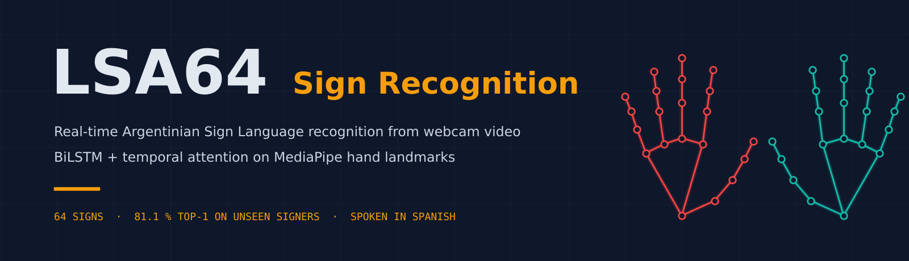
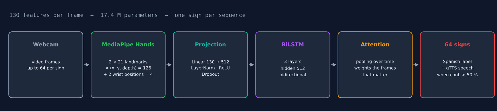
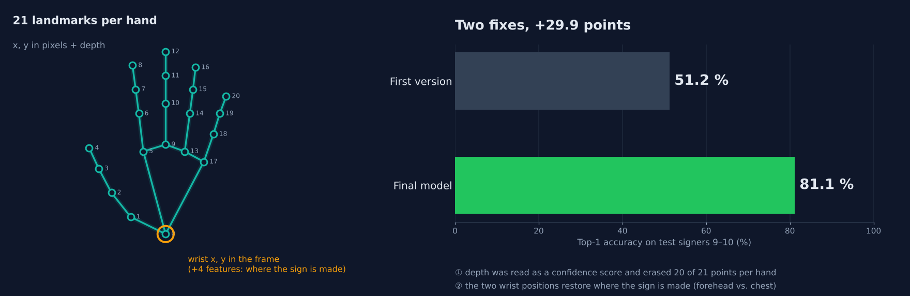
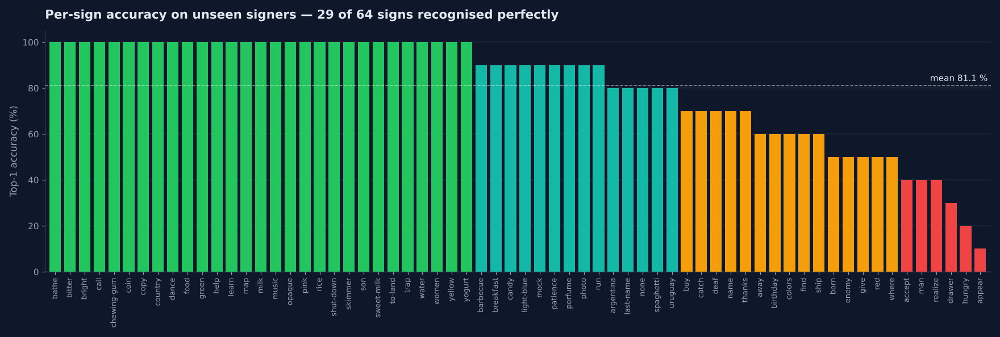
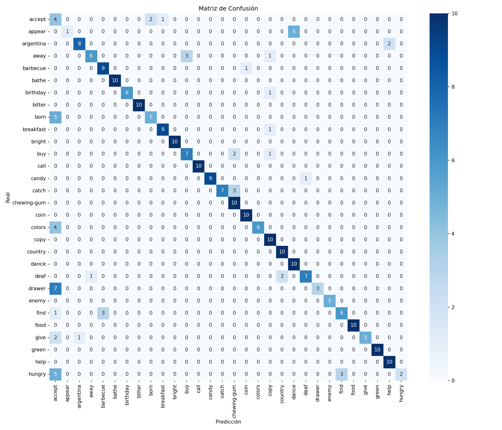
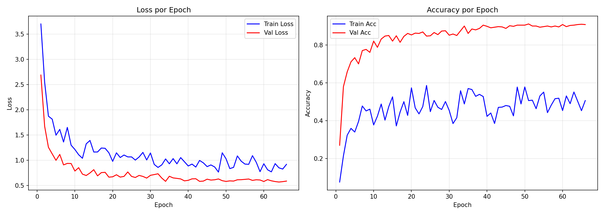
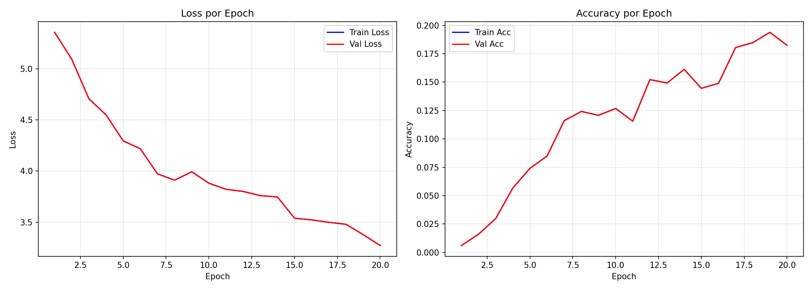

<div align="center">



<br>

**Recognises the 64 signs of LSA64 from a webcam in real time, using only hand landmarks — and says each
sign aloud in Spanish.**

[](LICENSE)


[How it works](#how-it-works) · [Results](#results) · [What made the difference](#what-made-the-difference) · [Usage](#usage) · [Presentation](docs/LSA64_presentacion.pdf)

</div>

---

<div align="center">

| Test set | Top-1 | Top-5 | Macro F1 |
|:---|:---:|:---:|:---:|
| LSA64, **signers never seen in training** (9 and 10), 640 videos | **81.1 %** | **94.1 %** | 0.815 |

</div>

> **Signer-independent by design.** LSA64 has 10 signers: 1–6 train, 7–8 validate and 9–10 test, so the
> score measures how well the model generalises to people it has never seen.

## Highlights

<table>
<tr>
<td width="50%" valign="top">

### ✋ Hands only
MediaPipe extracts both hands in every frame: **130 features**, no body model, no RGB pixels. Extraction
for all 3 200 LSA64 videos runs in parallel on the CPU in ~34 minutes.

### 🧠 BiLSTM + temporal attention
A 3-layer bidirectional LSTM reads up to 64 frames; attention pooling weights the frames that carry the
sign. 17.4 M parameters.

</td>
<td width="50%" valign="top">

### 🔁 Transfer learning
Backbone pre-trained on **AUTSL** (226 Turkish signs), then fine-tuned on LSA64 with focal loss, label
smoothing, Mixup and speed / keypoint jitter.

### 🔊 Live, in Spanish
Webcam dashboard with hand overlay, prediction smoothing, the 64 classes translated to Spanish and
asynchronous text-to-speech (gTTS) when confidence exceeds 50 %.

</td>
</tr>
</table>

## How it works

<p align="center">
  
</p>

1. **Landmarks** (`08_extract_lsa64.py`): MediaPipe extracts both hands from every frame — 42 points ×
   (x, y, depth) in pixel space = 126 values — plus the x, y position of both wrists relative to the
   frame (4 values): **130 features per frame**, up to 64 frames per sign.
2. **Model** (`model.py`): linear projection 130 → 512, **3-layer bidirectional LSTM** (hidden 512),
   attention pooling over time and a classification head.
3. **Training** (`09_finetune_lsa64.py`): transfer learning from the **AUTSL** backbone (69.9 % top-1 /
   90.6 % top-5 on unseen signers), then fine-tuning on LSA64.
4. **Live inference** (`10_live_inference.py`): webcam, hand-landmark overlay on a dark dashboard,
   prediction smoothing and spoken Spanish output in a background thread.

## What made the difference

<p align="center">
  
</p>

The first version scored 51.2 % on test. Two fixes brought it to 81 %:

- **A normalisation bug.** The function that centred the hands treated the depth coordinate as a
  confidence score; because fingers pointing at the camera have negative depth, it erased 20 of the 21
  points of each hand before training. Masking on x, y instead restored the data.
- **Global position.** Centring the hands removed where they are relative to the body, so signs with the
  same hand shape made at the forehead or at the chest became indistinguishable. Adding the two wrist
  positions (126 → 130 features) restored that information.

Earlier, a multi-model pipeline (YOLO pose for the body + MediaPipe for the hands, 177 features) was
dropped in favour of the hand-centric one: faster, simpler and more accurate.

## Results

<p align="center">
  
</p>

**29 of the 64 signs are recognised perfectly.** Hardest on the test signers: *appear* (10 %), *hungry*
(20 %), *drawer* (30 %). Per-class precision, recall and F1: [`results/lsa64_classification_report.csv`](results/lsa64_classification_report.csv).

<details>
<summary><b>Confusion matrix and training curves</b></summary>
<br>





</details>

<details>
<summary><b>AUTSL pre-training (226 Turkish signs)</b></summary>
<br>

69.9 % top-1 / 90.6 % top-5 on unseen signers. Report: [`results/autsl_classification_report.csv`](results/autsl_classification_report.csv).



</details>

## Installation

```bash
git clone https://github.com/SlightlyDazed/lsa64-sign-recognition.git
cd lsa64-sign-recognition
python -m venv .venv && source .venv/bin/activate
pip install -r requirements.txt
```

Install PyTorch for your hardware (CUDA, ROCm or CPU) following the official instructions. Speech output
uses gTTS (needs internet) and plays the audio with VLC (`cvlc`). The MediaPipe models are downloaded
automatically on first use.

## Usage

```bash
python 10_live_inference.py                 # live recognition with the included model (--camera N)
```

To reproduce training and evaluation, download LSA64 from its authors and place the videos in `all/`:

```bash
python 08_extract_lsa64.py                  # landmarks → data/processed/lsa64/
python 09_finetune_lsa64.py                 # fine-tune from models/autsl_finetuned.pth (--from-scratch to skip it)
python 07_evaluate.py --dataset lsa64       # report, confusion matrix and summary in results/
```

<details>
<summary><b>Earlier experiments and the AUTSL stage</b></summary>
<br>

The AUTSL stage (`02_preprocess_frames.py`, `05_finetune_autsl.py`) and the earlier WLASL /
YOLO-pose experiments (`01_extract_datasets.py`, `03_convert_to_yolo.py`, `04_train_wlasl.py`,
`08_export_model.py`, `run_pipeline.py`) are kept for completeness. All settings live in `config.py`.

</details>

## Repository contents

| Path | Content |
|---|---|
| `models/lsa64_finetuned.pth` | Final LSA64 model (weights only) and `lsa64_classes.json` |
| `models/autsl_finetuned.pth` | AUTSL pre-trained backbone used for transfer learning |
| `results/` | Evaluation reports, confusion matrices and training curves (LSA64 and AUTSL) |
| `docs/LSA64_presentacion.pdf` | Project presentation (Spanish, PDF) |
| `docs/images/`, `docs/make_readme_figures.py` | README figures and the script that draws them from `results/` |

## Datasets

Not included. LSA64: Ronchetti et al., *LSA64: An Argentinian Sign Language Dataset*, 2016.
AUTSL: Sincan and Keles, *AUTSL: A Large Scale Multi-modal Turkish Sign Language Dataset and Baseline
Methods*, IEEE Access, 2020. Check each dataset's terms of use before training on it.

## License

Code released under the [MIT License](LICENSE). MediaPipe models are distributed by Google under
Apache 2.0.
